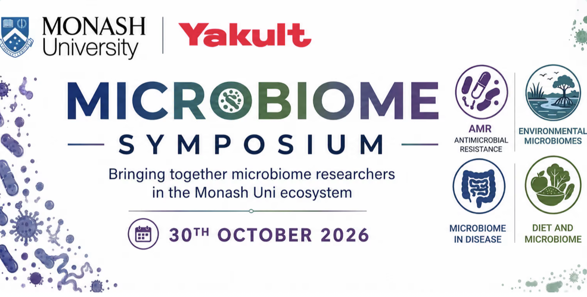
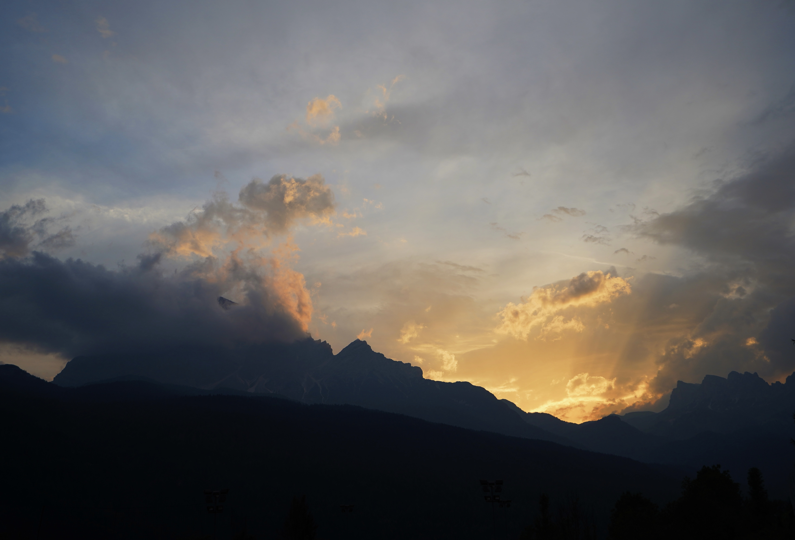
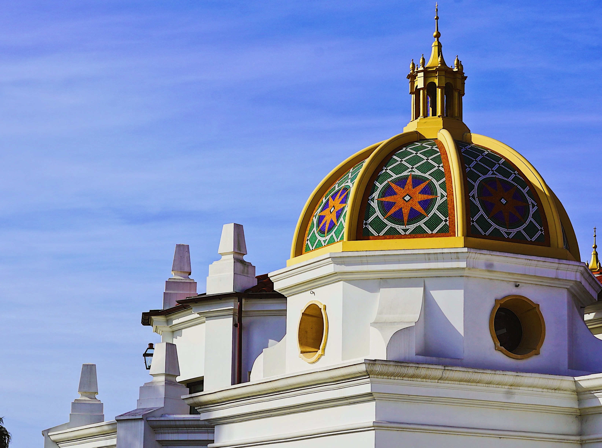

# Blog

Stay tuned for future news and updates from our lab 

### Researcher cultivates collaboration at University of California San Diego
*First published 20, JUN 20219 on * 

Dr Andre Mu, a microbial ecologist and bioinformatician at the Doherty Institute has spent the past 18 months cultivating collaborations with Professor Rob Knight at the University of California San Diego (USCD), the founder of the American Gut Project, a worldwide research project mapping human microbiomes through citizen science.

Dr Mu tells us about his time at USCD and what he hopes for the future of this collaboration.

April 3rd, 2018

“…Welcome to San Diego, where the local time is 10:45pm. The captain has switched off the seatbelt sign; if you have your mobile device at hand, you can now turn off airplane mode…”

My research into microbiome sciences led me to a six-month exchange to establish a collaboration with Professor Rob Knight (University of California San Diego; co-founder of the Earth Microbiome Project) through a competitive Endeavour Research Fellowship.

My primary research involves understanding the key role bacterial communities within our bodies play in keeping us healthy. A new and powerful method to study these communities is called metagenomics.

Metagenomics uses high-throughput DNA sequencing to catalogue all the microorganisms in a complex sample, such as from fecal material.

Microbiome sciences has allowed many new discoveries. It shown for instance that a specific group of gut microbes protect humans from being infected with antibiotic-resistant Enterococcus faecium.

The Knight lab are world-leaders in microbiome sciences, and develop bioinformatic tools (e.g., QIIME2) that facilitate the analysis of microbial communities across many different ecosystems including host-associated, and natural environments.

During my time as a visiting scholar at UCSD, I developed a deeper understanding of the statistical algorithms, and bioinformatic approaches, designed to interrogate the dynamics of microbial communities.

Importantly, I was able to integrate the analysis of both microbiota (amplicon 16S rRNA gene sequencing) and metabolomic (LC-MSMS) datasets towards understanding the role of the gut microbiome in facilitating the transmission, and persistence, of vancomycin resistant Enterococcus faecium (VREfm) – an important hospital superbug.

My time abroad provided me with the expertise to establish amplicon 16S rRNA gene sequencing as a service within Doherty Applied Microbial Genomics.  

Further, I work closely with Metabolomics Australia (Bio21) towards implementing standardised workflows for metabolite profiling in microbiome sciences.

Through this collaborative platform, myself and key researchers from the Doherty Institute (Tim Stinear, Ben Howden, and Nicole Isles) are leading the microbiome sciences in a large study with Julian Simmons (Melbourne School of Psychological Sciences, UoM) that is hosted by the Melbourne Museum.

This study aims to profile the oral microbiome of Victorians as part of the Museum’s exhibit, Gut Feelings; and a living microbiome map will display the microbial diversity of more than 1000 participants from across Victoria. More information on this project can be found here.

May 26th, 2019

“…Welcome to San Diego, where the local time is 10:45pm. The captain has switched off the seatbelt sign; if you have your mobile device at hand, you can now turn off airplane mode…”

Déjà vu.

My return to UCSD immediately followed a Doherty Institute co-hosted symposium, View to the future for public health and personalized infectious disease care, where I invited Professor Rob Knight as a keynote speaker.

The title of Rob’s keynote was “Impacts of microbiome research on patient-directed therapies”, and this was the theme for my recent visit to San Diego.

Over the course of my two-week visit, I had the opportunity to consolidate our understanding of the metabolic relationships between gut commensals and bacterial pathogens that can be targeted for eliminating VREfm colonisation, and (wrap-up a study investigating the impacts of adjunct bacteriophage therapy to a patient’s microbiome in the context of treating staphylococcal infection and bacteremia.

Bacteriophage therapy is proving to be a viable non-antibiotic alternative to treating infectious diseases, and research into the microbiome is an exciting area to progress towards.

I also spent quality time with close friends eating our way through a lot of Italian and Mexican foods, and would catch the sunset over the horizon at Torrey Pines Gliderport and Coronado beach (see photo).

Near future

“…Welcome to San Diego, where the local time is 10:45pm. The captain has switched off the seatbelt sign; if you have your mobile device at hand, you can now turn off airplane mode…”

Back to the future.

I aim to continue the strong collaborative links between UCSD and the Doherty Institute, and to work at the vanguard of microbiome sciences across multiple ecosystems; from infectious diseases, to phage therapy, and environmental sciences.

 
### Monash Microbiome Symposium, 2026
We are hosting the Monash Microbiome Symposium for its second year running.  
Our organising committee is excited to present four sessions spanning microbiome sciences in:  
(1) antimicrobial resistance  
(2) environmental microbes  
(3) diet, and 
(4) disease. 

*Antimicrobial resistance* is one of the key sessions to feature a keynote. This years keynote will be delivered by Prof. Anton Peleg, Director of the Department of Infectious Diseases at The Alfred Hospital, and Director of the Monash Centre to Impact AMR. 

**Organising committee** _alphabetical_  
- Amelia Belich 
- Ashray Gunjur 
- Andre Mu 
- Rikeish Muralitharan 
- Francesco Ricci 
- CK Yao 

### A collection of photos taken by lab members

Sony a7 iii; Dolomites, Italy; A. Mu

Sony a7 iii; Nettuno beach, Rome, Italy; A. Mu

Sony a7 iii; Santa Barbara, California, USA; A. Mu










